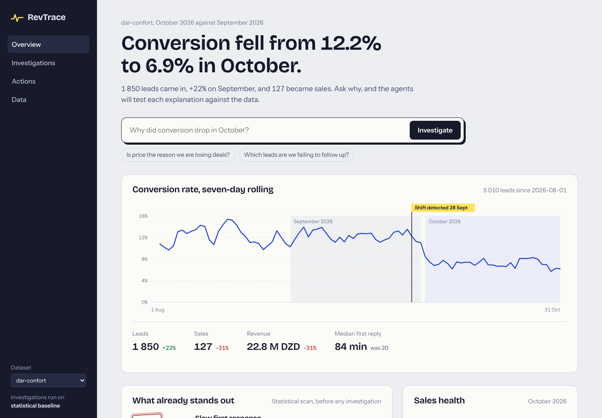
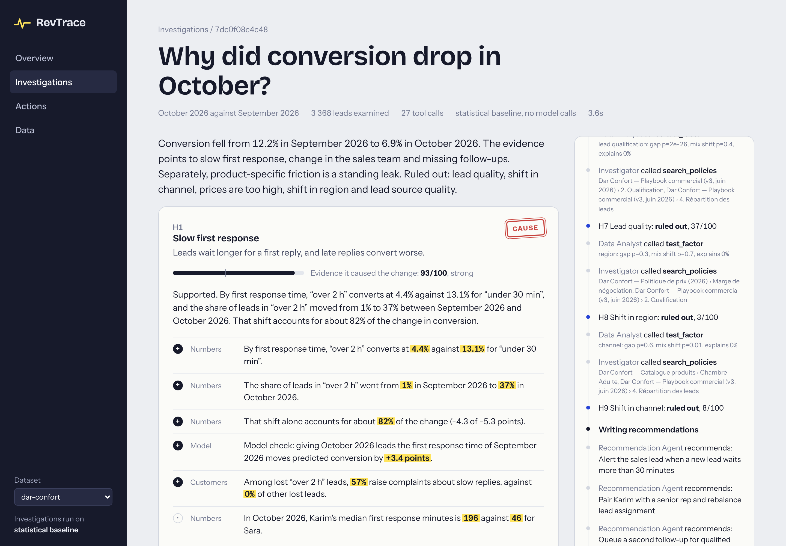

# RevTrace

An agentic system that investigates why sales changed. You ask a question; a small team of agents forms
hypotheses, tests each one against the data, the customer conversations and the company's own playbook,
and returns a verdict per hypothesis with the evidence attached. Fixes are proposed as actions that a
person approves.



## What it does

```
"Why did conversion drop in October?"
            │
       Orchestrator ── scopes the change, finds when it started
            │
       Investigator ── proposes competing hypotheses
            │
   ┌────────┴─────────┐
Data Analyst    Conversation Agent     (tools over leads, orders, messages)
   └────────┬─────────┘
            │   + policy search (RAG over playbook, pricing rules, catalog)
            ▼
     Verdict per hypothesis ── cause · standing leak · ruled out
            │
  Recommendation Agent ── actions, queued for human approval
```

On the bundled dataset (a fictional Algerian furniture retailer, 5 000 leads, conversations in Darija and
French), conversion falls from 12.2% to 6.9%. RevTrace attributes it to slower first replies after a
staffing change and to missed second follow-ups, flags one product as a standing leak caused by a
six-week lead time, and rules out price even though a quarter of lost customers complain about it.



## Design decisions

**The model never produces a number.** Agents choose which tools to call and explain what they find.
Every figure comes from a tool, and every verdict from a scoring function:

| Component | Question | Test |
|---|---|---|
| Gap (35%) | Does this factor move conversion at all? | Chi-square across segments, relative gap between best and worst |
| Shift (25%) | Did the mix change between the two periods? | Chi-square on segment shares |
| Attribution (40%) | How much of the change does that shift explain? | Mix-shift decomposition of the conversion delta |

A factor that moves conversion and whose mix changed is a **cause**. One that moves conversion but did
not change is a **standing leak**. One that does not move conversion is **ruled out**, whatever customers
say about it. A gradient-boosted conversion model, trained per dataset, gives a second opinion through a
counterfactual: restore last month's distribution for one factor, re-predict, and report the points recovered.

**One toolkit, three consumers.** The functions in `toolkit.py` are called by the agents in-process,
exposed over MCP for Claude Desktop or any other client, and used by the baseline engine.

**A baseline to beat.** Without an API key, RevTrace runs a deterministic engine that tests every
dimension with the same tools and scoring. It makes the project usable offline and gives the agents
something to be measured against.

**Agents propose, people approve.** Actions are stored as pending. Approval is only possible in the
dashboard; the MCP server can list pending actions but cannot approve them.

## Quickstart

### In the browser

Click **Code → Codespaces → Create codespace on main** on the repository page. The environment installs
itself and opens the dashboard when it is ready (about three minutes the first time).

### On your machine

```bash
python -m venv .venv && source .venv/bin/activate
pip install -e ".[dev]"
cd frontend && npm install && npm run build && cd ..
revtrace serve
```

On Windows, activate the environment with `.venv\Scripts\activate` instead. Requires Python 3.11+ and Node 20+.

Open http://127.0.0.1:8000. With no configuration the baseline engine runs. To switch the agents on,
copy `.env.example` to `.env` and set a provider:

```bash
REVTRACE_PROVIDER=anthropic
ANTHROPIC_API_KEY=...
```

Any OpenAI-compatible endpoint works too (`REVTRACE_PROVIDER=openai` with `REVTRACE_BASE_URL` and
`REVTRACE_MODEL`), including a local Ollama server.

From the terminal:

```bash
revtrace investigate "Why did conversion drop in October?"
revtrace model          # model card: AUC, Brier score, drivers
revtrace eval           # score the engine on scenarios with known causes
```

## MCP server

`revtrace mcp` serves the toolkit over stdio: sales metrics, factor tests, conversation search, policy
search, record lookups and `run_investigation`. For Claude Desktop:

```json
{
  "mcpServers": {
    "revtrace-sales": {
      "command": "/absolute/path/to/revtrace/.venv/bin/revtrace",
      "args": ["mcp"]
    }
  }
}
```

## Evaluation

`revtrace eval` generates datasets with planted causes (slow replies, missed follow-ups, a poor lead
source, a price increase, alone or combined), a standing product leak in every one, and price complaints
as a decoy wherever price is not the cause. It then checks which causes the engine confirms.

Baseline engine, 16 scenarios:

| Metric | Result |
|---|---|
| Precision on confirmed causes | 96% |
| Recall | 96% |
| Scenarios with every cause found and nothing extra | 88% |
| Price decoy rejected | 100% |
| Standing leak identified | 100% |

`revtrace eval --mode agentic` runs the same suite through the LLM agents, where the question becomes
whether the Investigator proposes the right hypotheses to begin with.

## Your own data

Upload from the Data page or drop a folder into `datasets/`:

| File | Required | Columns |
|---|---|---|
| `leads.csv` | yes | `lead_id`, `created_at`, `status` (`won`/`lost`), plus any categorical columns to segment by. `first_response_minutes` and `followups_count` are recognised when present. |
| `orders.csv` | no | `lead_id`, `amount_<currency>` |
| `conversations.json` | no | `[{lead_id, channel, messages: [{from, at, text}]}]` |
| `docs/*.md` | no | Playbooks and policies, indexed for retrieval |

## Layout

```
src/revtrace/
  dataset.py       loading, validation, derived dimensions
  analytics.py     metrics, factor test, changepoint, conversation themes
  model.py         conversion model and counterfactuals
  rag.py           chunking and hybrid retrieval over policy documents
  toolkit.py       the tools, with schemas derived from signatures
  llm/             provider adapters (Anthropic, OpenAI-compatible)
  engine/          investigation loop, agents, baseline, scoring, recommendations
  service.py       runs, live event streams, approvals
  api.py           FastAPI, server-sent events
  mcp_server.py    MCP server
  synth.py         scenario generator
  evaluation.py    scoring against planted causes
frontend/          React dashboard
tests/             pytest suite
```

## Limits

- Verdicts describe association in observational data. The decomposition says how much of the change
  coincides with a shift, not that the shift is proven causal; overlapping factors (a slow rep and slow
  replies) each receive credit, so impact estimates should not be summed.
- Retrieval is lexical by default (word and character TF-IDF). Multilingual dense embeddings are optional:
  `pip install -e ".[embeddings]"` and `REVTRACE_EMBEDDINGS=fastembed`.
- Conversation themes are keyword lexicons; the Conversation Agent can search freely on top of them.
- Approved actions are written to RevTrace's own task store. Connecting a CRM means replacing
  `Service.decide`.
- Periods are calendar months.

## Development

```bash
make test    # pytest
make lint    # ruff
```

MIT licensed.
